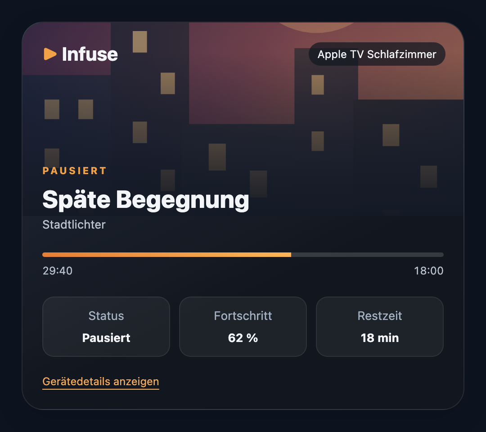
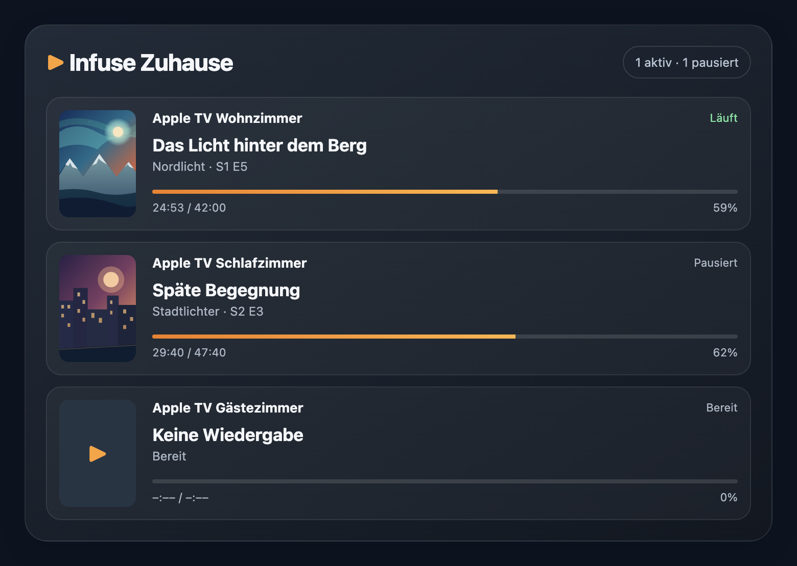

<h1 align="center">Infuse Now Playing for Home Assistant</h1>

<strong>See what is playing. Make your home react.</strong> Local playback monitoring for Infuse, designed for Home Assistant.

**Infuse Now Playing** connects Firecore's local, read-only Now Playing API to Home Assistant. See what is playing on your devices and use playback changes in automations—without a cloud account or remote playback control.

## Features

- **Automatic device discovery** via Bonjour / mDNS, with manual host and port setup if needed.
- **Media player and sensors** for playback state, title, progress, remaining time and more.
- **Playback automation events** for changes in playback or media.
- **Multiple Infuse devices** tracked independently, even when they share an account.
- **Optional movie and TV artwork** from TMDB.
- **Two built-in dashboard cards** for one player or the whole household—no separate cards installation.
- **Library and stream URL-generation actions** for supported Infuse links (not remote playback controls).

## Requirements

- **Infuse 8.5.9 or newer** with **Settings → Playback → Now Playing API** enabled.
- Home Assistant and your Infuse device on a network where the local API is reachable.
- Bonjour / mDNS for automatic discovery, or the device's current IP address and API port for manual setup.

## Installation & setup

1. **Install the integration.** In **Home Assistant 2026.11+**, open **Settings → Marketplace**, search for **Infuse Now Playing** and install it. On **Home Assistant 2026.10 or older**, use **HACS** and search for the same integration. [Open the Marketplace listing](https://my.home-assistant.io/redirect/marketplace_repository/?owner=Manantra&repository=ha-infuse&category=integration).
2. **Restart Home Assistant.** Open Infuse on your device and enable **Now Playing API** in Infuse's playback settings.
3. **Add your device.** Go to **Settings → Devices & services** and confirm the discovered **Infuse Now Playing** device, or select **Add integration → Infuse Now Playing**. If discovery is unavailable, choose manual setup and enter the current host/IP and API port.
4. **Start playing something.** Your new media player and sensors appear in Home Assistant. Add either built-in card to a dashboard if you'd like a visual overview.

**Can't find the integration?** Add `https://github.com/Manantra/ha-infuse` as a custom **Integration** repository in Marketplace/HACS. For a fully manual installation, copy `custom_components/infuse` into your Home Assistant `custom_components` directory and restart.

**Both cards are included in this integration.** Do not install the old separate cards plugin for a new setup. Already using the former `ha-infuse-cards` repository? See the [migration guide](docs/migration.md).

## Built-in dashboard cards

| Infuse Now Playing — single device | Infuse Household — multiple devices |
|:---:|:---:|
|  |  |

*Actual card designs shown with fictional example content.*

Edit a Home Assistant dashboard and choose **Add card → Infuse Now Playing** or **Infuse Household**. Both have visual editors: select your media player(s), adjust display options and arrange your household view.

The cards use the bundled resource `/api/infuse/cards/infuse-dashboard-cards.js`. Advanced YAML options, resource setup and legacy card migration are documented in [Advanced setup](docs/advanced.md) and [Migration](docs/migration.md).

## Optional TMDB artwork

Infuse provides playback metadata but not poster images through its local Now Playing API. To add covers, get an **API Read Access Token** from [TMDB](https://www.themoviedb.org/settings/api) and enter it when adding your Infuse device or later under **Settings → Devices & services → Infuse Now Playing → Configure**.

The token is **optional**: playback status, titles, progress and automations work without it. When enabled, artwork requests are made to TMDB; local playback updates do not wait for them. See [Advanced setup](docs/advanced.md) for token management and poster behavior.

## Limitations, privacy & support

This is a community integration, not affiliated with Firecore or Home Assistant. The Now Playing API is **read-only**: it cannot remotely play/pause/seek or report the active Infuse profile. It also does not expose the full Infuse library. Supported library/stream actions generate links rather than controlling playback.

The local Infuse endpoint uses **HTTP without authentication or encryption**. Keep it on a trusted LAN; never expose it directly to the internet. TMDB lookups are optional, and Home Assistant history or automation events may record what you watch.

Need help? See [Troubleshooting](docs/troubleshooting.md), [Advanced setup](docs/advanced.md), [Architecture](docs/architecture.md), or [open an issue](https://github.com/Manantra/ha-infuse/issues) with redacted diagnostics. For changes between releases, see [GitHub Releases](https://github.com/Manantra/ha-infuse/releases).

MIT Licensed. Infuse and Firecore are trademarks of their respective owners.
